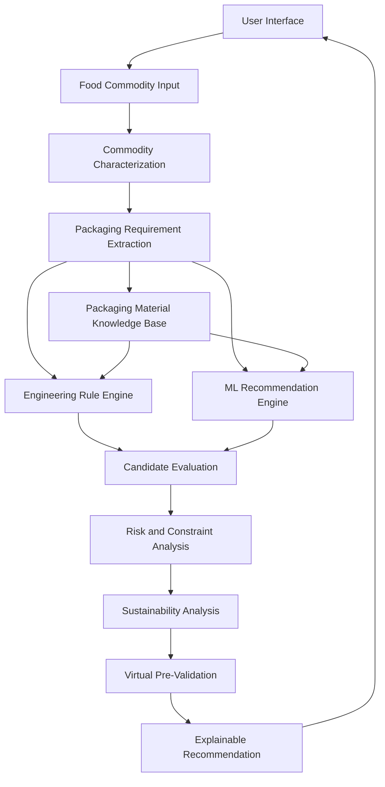

# PACKINTELLECT

### AI-Based Intelligent Food Packaging Material Recommendation System for Food Commodities

> An AI-assisted food packaging engineering and virtual pre-validation platform that recommends suitable packaging materials by combining food characteristics, packaging-property constraints, engineering rules, sustainability considerations, and machine-learning-assisted decision support.

**Smart India Hackathon 2026**  
**Problem Statement:** SIH26236  
**Ministry:** Ministry of Food Processing Industries (MoFPI)  
**Domain:** Agriculture, FoodTech & Rural Development  
**Category:** Software

---

# Project Overview

Selecting a suitable packaging material for a food commodity requires consideration of multiple interacting factors, including:

- Moisture content
- Fat/oil content
- pH
- Respiration rate
- Desired shelf life
- Storage temperature
- Relative humidity
- Transportation conditions
- Oxygen sensitivity
- Moisture sensitivity
- Mechanical requirements
- Packaging barrier properties

PACKINTELLECT addresses this decision-making challenge through an intelligent recommendation workflow that maps food and storage characteristics to packaging-material properties.

The system is designed as a **decision-support and virtual pre-validation platform**, helping users understand not only which material is recommended, but also the engineering factors and constraints influencing the recommendation.

---

# Problem Statement

Different food commodities require different packaging characteristics.

A packaging material suitable for a dry commodity may not be suitable for a high-moisture food. Fresh fruits and vegetables introduce additional requirements because respiration continues after harvesting.

Incorrect packaging selection can contribute to:

- Moisture migration
- Oxidation
- Quality loss
- Reduced shelf life
- Spoilage
- Inappropriate gas exchange
- Unnecessary material usage
- Increased environmental impact

The objective of PACKINTELLECT is to provide an intelligent software-based decision-support system that assists users in selecting suitable packaging materials based on commodity characteristics, storage conditions, packaging requirements, and engineering constraints.

---

# Proposed Solution

PACKINTELLECT combines multiple decision layers:

1. Food commodity characterization
2. Packaging requirement extraction
3. Engineering-rule evaluation
4. Packaging-material property matching
5. Machine-learning-assisted recommendation
6. Risk and constraint analysis
7. Sustainability considerations
8. Explainable recommendations
9. Virtual pre-validation

The system produces ranked candidate materials together with the factors that influence their recommendation.

---

# Core Concept

```text
Food Commodity
      |
      v
Commodity Characterization
      |
      +-- Moisture
      +-- Fat/Oil
      +-- pH
      +-- Respiration
      +-- Shelf-Life Target
      +-- Temperature
      +-- Humidity
      +-- Storage / Transport
      |
      v
Packaging Requirement Extraction
      |
      v
Packaging Material Knowledge Base
      |
      +-- OTR
      +-- WVTR
      +-- Thickness
      +-- Sealability
      +-- Mechanical Strength
      +-- Gas Permeability
      +-- MAP Suitability
      |
      v
Engineering Rules + ML Recommendation
      |
      v
Candidate Material Ranking
      |
      v
Virtual Pre-Validation
      |
      v
Explanation + Risk + Sustainability
      |
      v
Final Recommendation
```

---

# Key Features

## Intelligent Packaging Recommendation

Analyzes food commodity characteristics and packaging requirements to generate ranked packaging-material recommendations.

## Multi-Criteria Evaluation

Evaluates candidate materials using multiple engineering parameters instead of relying on a single property.

Key factors include:

- Oxygen Transmission Rate (OTR)
- Water Vapour Transmission Rate (WVTR)
- Thickness
- Sealability
- Mechanical strength
- Gas permeability
- MAP suitability
- Storage conditions
- Shelf-life requirements

## Explainable Recommendations

The system provides an explanation of the major food characteristics, packaging requirements, material properties, and constraints influencing each recommendation.

## Sustainability-Aware Selection

Sustainability considerations are incorporated alongside technical packaging requirements when comparing candidate materials.

## Risk and Constraint Analysis

The system identifies potential compatibility issues and engineering constraints before presenting the final recommendation.

## Virtual Pre-Validation

Candidate materials undergo software-based compatibility checks against the specified food, storage, and packaging requirements.

## Respiring Produce Support

Fresh produce is treated differently because respiration continues after harvest. The system considers gas-exchange requirements rather than simply maximizing barrier performance.

---

# Respiring Produce Handling

Fresh fruits and vegetables continue to respire after harvesting.

Packaging selection for respiring commodities requires consideration of:

- Respiration rate
- Oxygen availability
- Carbon dioxide accumulation
- Gas permeability
- Storage temperature
- Relative humidity
- Target shelf life

The system distinguishes between conventional barrier-driven packaging requirements and cases where controlled gas exchange is important.

```text
Non-Respiring / Dry Commodity
          |
          v
Barrier Requirement Analysis
          |
          v
Candidate Material Ranking


Respiring Fresh Produce
          |
          v
Respiration Analysis
          |
          +-- O2 Requirement
          +-- CO2 Requirement
          +-- Gas Permeability
          +-- Storage Conditions
          |
          v
Controlled Gas-Exchange Evaluation
          |
          v
Candidate Material Ranking
```

---

# Virtual Pre-Validation

Before presenting a final recommendation, PACKINTELLECT evaluates the selected candidate against identified requirements.

```text
Candidate Material
        |
        v
Barrier Property Check
        |
        v
Moisture Requirement Check
        |
        v
Mechanical Requirement Check
        |
        v
Storage Condition Check
        |
        v
Gas-Exchange / Respiration Check
        |
        v
Sustainability Check
        |
        v
Risk and Constraint Assessment
        |
        v
Virtual Pre-Validation
```

The result can identify:

- Compatible requirements
- Potential conflicts
- Missing information
- Risk factors
- Properties requiring further validation

> Virtual pre-validation is a software-level engineering assessment. It does not replace laboratory testing, experimental shelf-life studies, regulatory approval, or commercial packaging validation.

---

# Existing Approaches vs PACKINTELLECT

## Existing Approaches

Food packaging material selection can already involve:

- Expert knowledge
- Material-property databases
- Engineering rules
- Barrier-property analysis
- Packaging compatibility studies
- Computational modelling
- AI/ML-assisted approaches

PACKINTELLECT therefore does not claim that AI-based packaging recommendation itself is new.

## PACKINTELLECT

The proposed system integrates multiple decision layers into a unified workflow:

```text
Food Characteristics
        +
Packaging Requirements
        +
Engineering Rules
        +
Material Properties
        +
ML-Assisted Ranking
        +
Risk Analysis
        +
Sustainability
        +
Virtual Pre-Validation
        +
Explainable Recommendation
```

## Differentiating Focus

PACKINTELLECT focuses on making packaging recommendations:

**Engineering-aware + Constraint-driven + Explainable + Sustainability-aware + Pre-validation-oriented**

Instead of simply producing:

> Recommended Material: X

the system aims to explain:

> Material X is recommended because its relevant packaging properties satisfy the identified food and storage requirements, while the following constraints and risks should be considered.

---

# System Architecture



---

# AI / ML Pipeline

The machine-learning component operates as a decision-support layer alongside engineering rules.

```text
Input Features
      |
      v
Data Preprocessing
      |
      v
Feature Engineering
      |
      v
ML Model
      |
      v
Candidate Scoring
      |
      v
Constraint Filtering
      |
      v
Material Ranking
      |
      v
Recommendation Explanation
```

Potential approaches include:

- Rule-based baseline
- Decision Tree
- Random Forest
- Gradient Boosting
- Other supervised-learning methods depending on the final dataset

The final model will be selected based on available data, validation results, interpretability, and prototype performance.

> No model accuracy is claimed until the implemented model has been evaluated using documented test data.

---

# Packaging Material Knowledge Base

The packaging knowledge base stores engineering properties associated with candidate packaging materials.

Potential materials include:

- LDPE
- HDPE
- PET
- PP
- Metallised films
- Aluminium foil laminates
- Paper-based materials
- Biodegradable materials
- Compostable materials
- Breathable packaging films

Potential properties include:

| Property | Application |
|---|---|
| OTR | Oxygen barrier evaluation |
| WVTR | Moisture barrier evaluation |
| Thickness | Structural and barrier considerations |
| Sealability | Package sealing |
| Mechanical Strength | Handling and transportation |
| Gas Permeability | Respiring commodities |
| MAP Suitability | Modified-atmosphere packaging |
| Recyclability | Sustainability assessment |

> Material-property values used in the final implementation should be documented with their corresponding sources.

---

# Input Parameters

## Food Characteristics

- Commodity type
- Moisture content
- Fat/oil content
- pH
- Respiration rate
- Oxygen sensitivity
- Moisture sensitivity

## Storage Conditions

- Target shelf life
- Storage temperature
- Relative humidity
- Storage environment
- Transportation conditions

## Packaging Requirements

- Required barrier performance
- Mechanical requirements
- Sealability requirements
- MAP requirement
- Sustainability preference

---

# Output

PACKINTELLECT produces a structured recommendation containing:

```text
Recommended Material
        |
        v
Recommendation Score
        |
        v
Material Compatibility
        |
        v
Engineering Explanation
        |
        v
Risk / Constraint Information
        |
        v
Sustainability Information
        |
        v
Virtual Pre-Validation Result
```

---

# Recommendation Example

Example input:

```text
Commodity:
Fresh Produce

Respiration:
High

Storage Temperature:
4-8 °C

Target Shelf Life:
7 days

Relative Humidity:
High
```

The system evaluates candidate materials based on:

- Gas transmission requirements
- Moisture behaviour
- Storage temperature
- Mechanical requirements
- Shelf-life target
- Packaging suitability

The final interface presents ranked candidates together with the factors influencing their ranking.

---

# Application Workflow

```text
1. Open PACKINTELLECT
        |
        v
2. Select / Enter Food Commodity
        |
        v
3. Enter Commodity Characteristics
        |
        v
4. Enter Storage Conditions
        |
        v
5. Define Packaging Requirements
        |
        v
6. Run Intelligent Analysis
        |
        v
7. View Ranked Recommendations
        |
        v
8. Inspect Engineering Explanation
        |
        v
9. Review Risk and Sustainability
        |
        v
10. View Virtual Pre-Validation
```

---

# Technology Stack

## Frontend

- React
- Vite
- JavaScript / TypeScript
- HTML5
- CSS3

## Backend

- Python
- FastAPI

## AI / Data Processing

- Python
- NumPy
- Pandas
- Scikit-learn

## Database

- SQLite for prototype development

## Visualization

- Interactive charts and UI components as required

> The technology stack will be updated to reflect the actual final implementation.

---

# Repository Structure

Current repository:

```text
PACKINTELLECT/
|
+-- Implementation/
+-- README.md
+-- .gitignore
```

Planned implementation structure:

```text
PACKINTELLECT/
|
+-- frontend/
+-- backend/
+-- ml/
+-- data/
+-- models/
+-- tests/
+-- docs/
+-- scripts/
|
+-- README.md
+-- .gitignore
+-- LICENSE
```

The repository structure will reflect the actual implemented project.

---

# Installation

> Installation instructions will be finalized after the implementation structure is completed.

Expected development environment:

```text
Python
Node.js
npm
Git
```

Expected backend setup:

```bash
cd backend
python -m venv venv
```

Windows:

```bash
venv\Scripts\activate
```

macOS / Linux:

```bash
source venv/bin/activate
```

Install backend dependencies:

```bash
pip install -r requirements.txt
```

Run the backend:

```bash
uvicorn app.main:app --reload
```

Frontend:

```bash
cd frontend
npm install
npm run dev
```

---

# Testing

Testing will cover:

- Input validation
- Recommendation logic
- Material-property matching
- Engineering constraints
- API endpoints
- ML inference
- Edge cases
- Respiring-produce scenarios
- Recommendation consistency
- Virtual pre-validation rules

Actual test results will be documented after implementation.

---

# Evaluation

The prototype will be evaluated using measurable criteria such as:

- Recommendation consistency
- Constraint satisfaction
- ML performance where applicable
- API response time
- Input validation
- Edge-case handling
- Explainability
- System usability

Performance values will only be reported after actual testing.

---

# Limitations

PACKINTELLECT is a prototype decision-support system.

Its recommendations:

- Do not replace laboratory testing.
- Do not replace experimental shelf-life studies.
- Do not replace regulatory approval.
- Depend on the quality and coverage of the packaging-property knowledge base.
- Depend on the accuracy and completeness of user-provided inputs.
- Require real-world validation before commercial deployment.

Sustainability indicators should not be interpreted as a complete Life Cycle Assessment unless validated LCA methodology and appropriate datasets are incorporated.

---

# Future Scope

Future development may include:

- Expanded packaging-material database
- Experimental validation
- Advanced shelf-life prediction
- Full Life Cycle Assessment integration
- Carbon-footprint estimation
- Cost optimization
- Dynamic MAP modelling
- IoT-based storage monitoring
- Cloud deployment
- Multilingual support
- Industry-specific packaging profiles
- Regulatory and standards integration

---

# Screenshots

Application screenshots will be added as development progresses.

Planned documentation:

```text
docs/
|
+-- screenshots/
    |
    +-- dashboard.png
    +-- commodity-input.png
    +-- recommendation.png
    +-- material-comparison.png
    +-- sustainability.png
    +-- pre-validation.png
```

---

# Research & References

Research documentation will be maintained under:

```text
docs/research/
```

The project will document:

- Food-packaging engineering principles
- Packaging material properties
- Barrier-property requirements
- Respiration and gas-exchange requirements
- Sustainability considerations
- Machine-learning methodology
- Dataset sources
- Standards and regulatory references

Important material-property values and engineering rules used by the system should have traceable sources.

---

# Team

## POWER HOUSE2026

**Team ID:** 123309

**Team Leader:** Reethik V

**Institution:** Saveetha Institute of Medical and Technical Sciences

| Member | Role |
|---|---|
| Reethik V | Team Leader |
| Pranav S | Team Member |
| Jashwanth S C | Team Member |
| Anirudh L | Team Member |
| Chandra Prakash D | Team Member |
| Sofia R V | Team Member |

---

# Smart India Hackathon 2026

This project is developed for:

**Smart India Hackathon 2026**

**Problem Statement:** SIH26236

**AI-Based Intelligent Food Packaging Material Recommendation System for Food Commodities**

**Team:** POWER HOUSE2026

**Institution:** Saveetha Institute of Medical and Technical Sciences

---

# Disclaimer

PACKINTELLECT is a Smart India Hackathon prototype intended for research, demonstration, and decision-support purposes.

Packaging recommendations generated by the system should be experimentally validated against relevant food-contact regulations, material specifications, storage conditions, shelf-life requirements, and applicable industry standards before real-world commercial deployment.

---

# License

This project is developed as part of Smart India Hackathon 2026.

License information will be added according to the team's chosen repository and intellectual-property policy.
